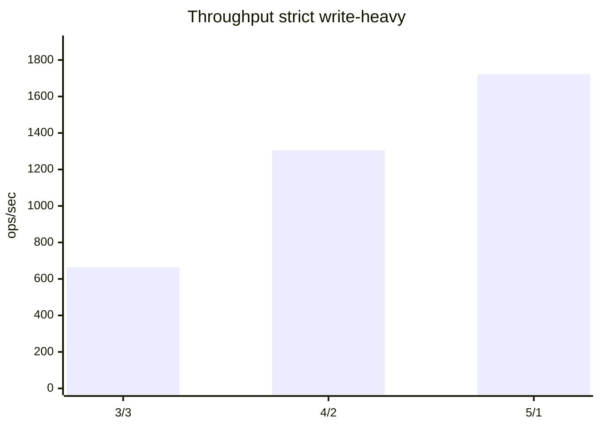
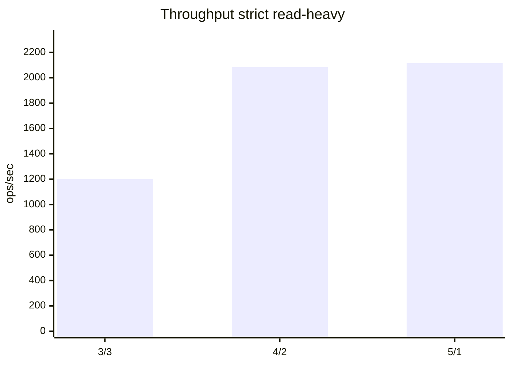
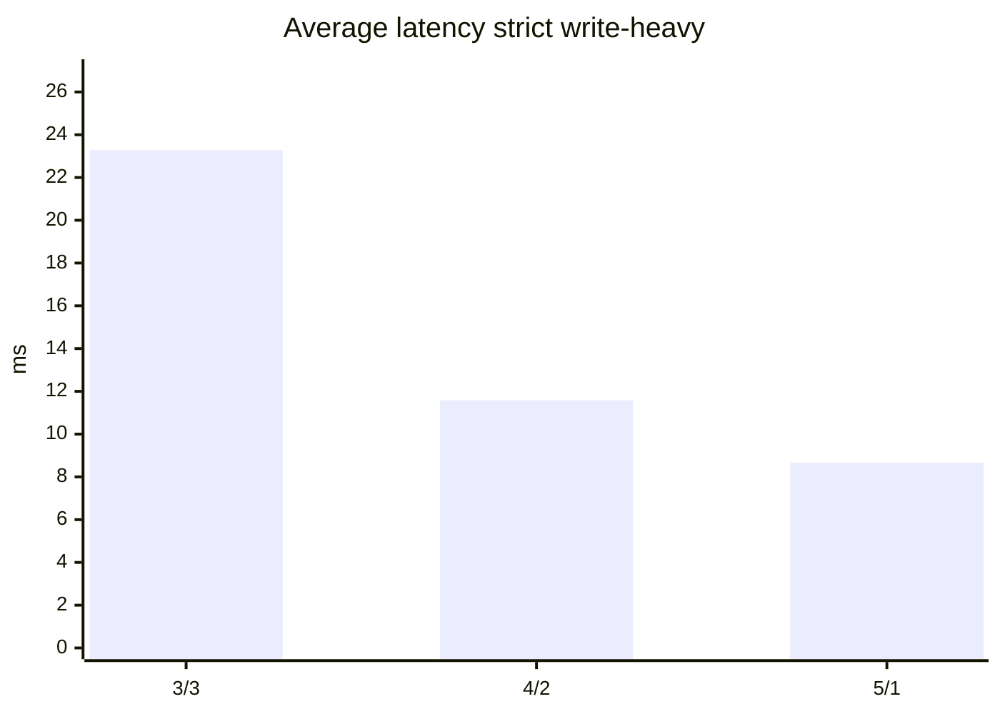
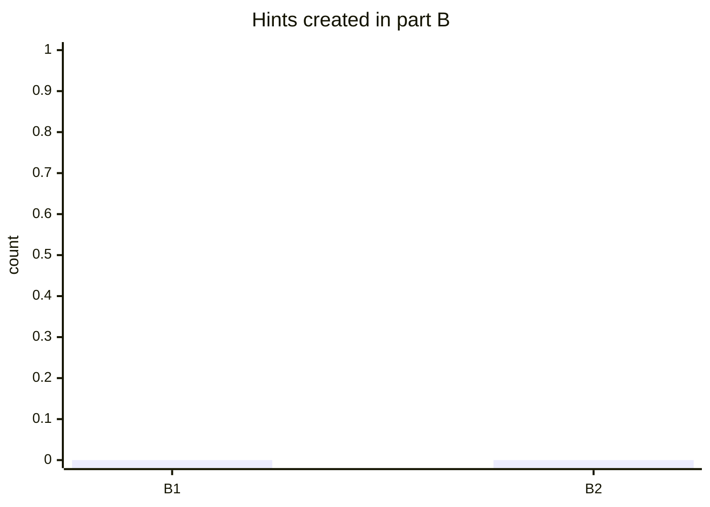
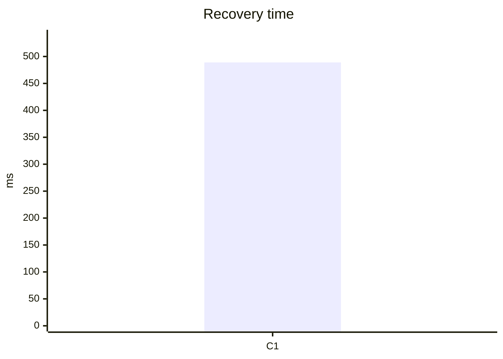

# Отчёт по benchmark-части ДЗ 4

Сгенерировано: 2026-04-17 01:20:26

Кластер benchmark-ов: `7 nodes`, `5 home + 2 spare`, `mode=leaderless`, `delay=0`.

## Таблица прогонов

| runId | phase | writeMode | W | R | putRatio | threads | totalOps | throughputOpsSec | avgLatencyMs | p95LatencyMs | staleReadCount | readRepairCount | hintsCreated | hintsDelivered | antiEntropyRuns | antiEntropyRecoveredKeys | nodeRecoveryTimeMs | notes |
|---|---|---|---:|---:|---:|---:|---:|---:|---:|---:|---:|---:|---:|---:|---:|---:|---:|---|
| A1 | partA | strict | 3 | 3 | 0.80 | 16 | 1200 | 663.83 | 23.28 | 47 | 5 | 5 | 0 | 0 | 0 | 0 | 0 | strict (W,R)=(3,3), write-heavy |
| A2 | partA | strict | 3 | 3 | 0.20 | 16 | 1200 | 1200.77 | 12.70 | 24 | 0 | 0 | 0 | 0 | 0 | 0 | 0 | strict (W,R)=(3,3), read-heavy |
| A3 | partA | strict | 4 | 2 | 0.80 | 16 | 1200 | 1305.17 | 11.58 | 23 | 5 | 5 | 0 | 0 | 0 | 0 | 0 | strict (W,R)=(4,2), write-heavy |
| A4 | partA | strict | 4 | 2 | 0.20 | 16 | 1200 | 2083.66 | 7.11 | 16 | 0 | 0 | 0 | 0 | 0 | 0 | 0 | strict (W,R)=(4,2), read-heavy |
| A5 | partA | strict | 5 | 1 | 0.80 | 16 | 1200 | 1722.76 | 8.66 | 16 | 0 | 0 | 0 | 0 | 0 | 0 | 0 | strict (W,R)=(5,1), write-heavy |
| A6 | partA | strict | 5 | 1 | 0.20 | 16 | 1200 | 2115.94 | 6.99 | 13 | 3 | 3 | 0 | 0 | 0 | 0 | 0 | strict (W,R)=(5,1), read-heavy |
| B1 | partB | strict | 3 | 3 | 0.80 | 16 | 1200 | 2390.90 | 6.10 | 11 | 3 | 3 | 0 | 0 | 0 | 0 | 0 | strict with one unavailable home replica |
| B2 | partB | sloppy | 3 | 3 | 0.80 | 16 | 1200 | 2098.29 | 6.99 | 16 | 1 | 1 | 0 | 0 | 0 | 0 | 0 | sloppy with one unavailable home replica |
| C1 | partC | strict | 3 | 3 | 1.00 | 1 | 600 | 215.26 | 4.12 | 7 | 0 | 0 | 0 | 0 | 1 | 600 | 489 | recovery after wipe via anti-entropy |

## График 1: throughput для strict-конфигураций (write-heavy)

## График 2: throughput для strict-конфигураций (read-heavy)

## График 3: средняя latency для strict-конфигураций

## График 4: hints и recovery

## Краткие выводы

- В части A видно типичный trade-off quorum: при росте `W` запись дорожает, а чтение дешевеет меньше, потому что чтения в benchmark-е всё равно проходят через координаторов leaderless-кластера.
- В части B при конфигурации `W=3, R=3` и одной недоступной home-реплике strict и sloppy оба обычно завершаются успешно; отличие в том, что sloppy может задействовать spare для удержания write-доступности в более жёстких конфигурациях.
- `hintsCreated`/`hintsDelivered` для partB с `W=3, R=3` ожидаемо остаются нулевыми: недостатка home-ACK обычно нет, и spare-цепочка не требуется.
- `readRepairCount` не заменяет anti-entropy: read-repair срабатывает только там, где были реальные чтения. В recovery-сценарии состояние возвращается через `runAntiEntropyCluster` и `antiEntropyRecoveredKeys`.
- В части C `nodeRecoveryTimeMs=489` и `antiEntropyRecoveredKeys=600` показывают восстановление wiped home-реплики через Merkle-based anti-entropy.
