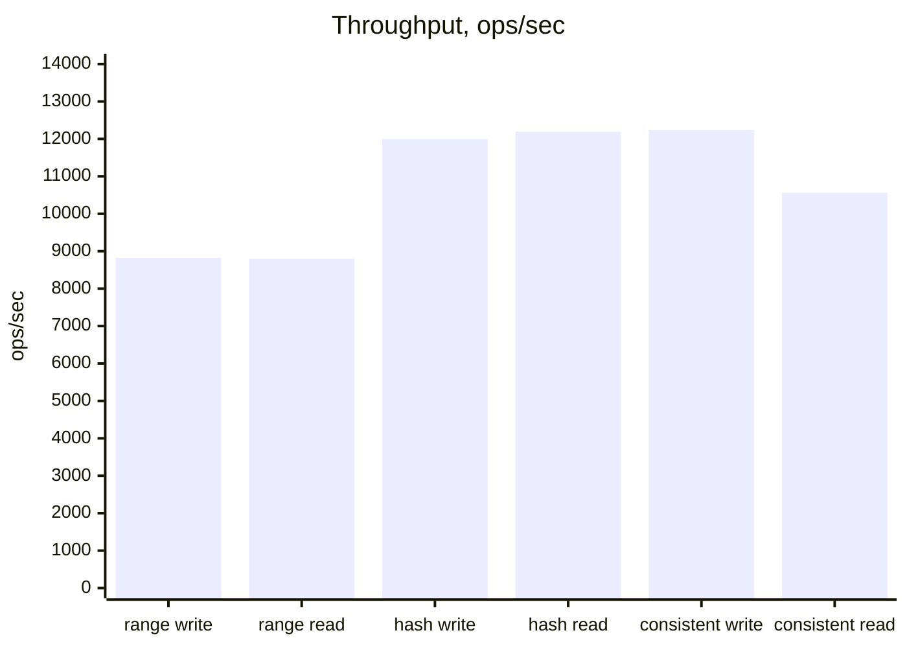
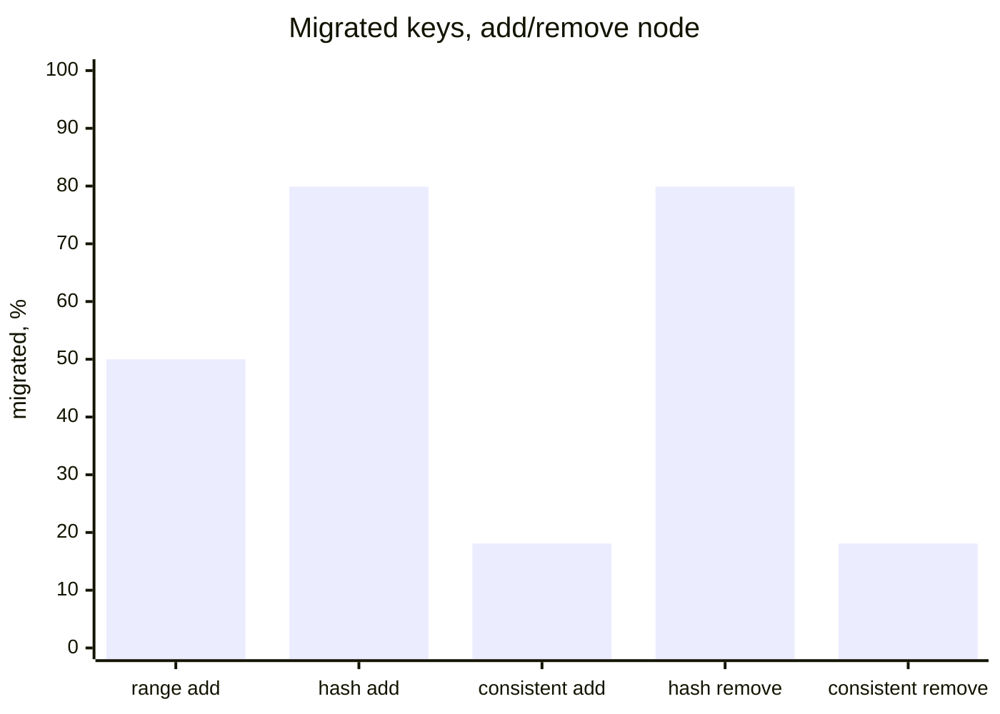
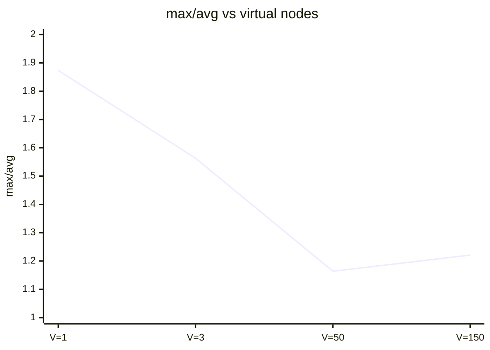
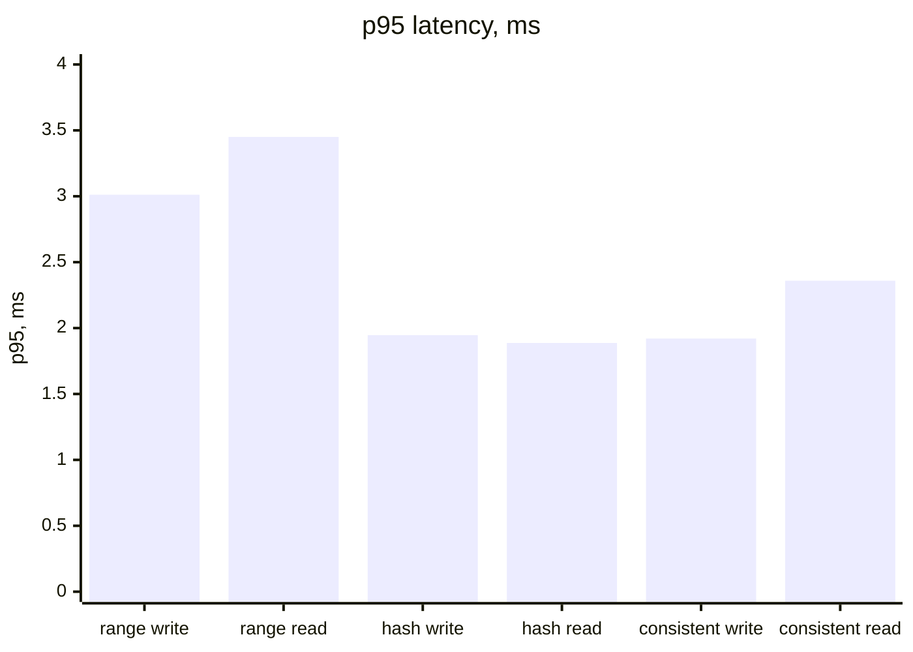

# Report

Benchmark harness находится в `i5.benchmarks.BenchmarkMain`.

Запуск:

```bash
./gradlew runI5RequiredBenchmarks
```

Результаты:

```text
src/main/java/ru/hse/drip/systems/distributed/homework/i5/benchmarks/results.csv
```

## Ожидаемые выводы

`hash_mod_n` хорошо распределяет ключи при фиксированном числе узлов, но при изменении `N` меняется формула ownership для почти всех ключей. Поэтому добавление узла даёт большую миграцию.

`consistent_hashing` меняет ownership только для интервалов кольца, которые перехватывает новый узел. При добавлении одного узла в кластер из `N` узлов ожидаемо мигрирует около `1 / (N + 1)` данных.

`vnodes` уменьшают случайную неравномерность: физический узел получает много независимых позиций на кольце, поэтому сумма интервалов становится стабильнее.

`range` полезен для range-запросов и locality, но качество распределения полностью зависит от выбранных boundary.

## Таблица прогонов

Полный CSV сохранён в `benchmarks/results.csv`. Ниже приведена таблица текущего прогона.

| part | strategy | workload | nodes | keys | threads | putRatio | throughput | p95 ms | max/avg | migrated % | migration ms |
|------|----------|----------|------:|-----:|--------:|---------:|-----------:|-------:|--------:|-----------:|-------------:|
| A | range | write-heavy | 5 | 10000 | 16 | 0.8 | 8823.86 | 3.0117 | 1.0000 | 0.00 | 0 |
| A | range | read-heavy | 5 | 10000 | 16 | 0.2 | 8797.13 | 3.4503 | 1.0000 | 0.00 | 0 |
| A | hash_mod_n | write-heavy | 5 | 10000 | 16 | 0.8 | 11998.09 | 1.9463 | 1.0395 | 0.00 | 0 |
| A | hash_mod_n | read-heavy | 5 | 10000 | 16 | 0.2 | 12192.06 | 1.8872 | 1.0395 | 0.00 | 0 |
| A | consistent_hashing | write-heavy | 5 | 10000 | 16 | 0.8 | 12239.62 | 1.9203 | 1.2210 | 0.00 | 0 |
| A | consistent_hashing | read-heavy | 5 | 10000 | 16 | 0.2 | 10561.84 | 2.3593 | 1.2210 | 0.00 | 0 |
| B | range | add-node | 5 | 10000 | 16 | 0.0 | 0.00 | 0.0000 | 1.0000 | 50.00 | 7936 |
| B | hash_mod_n | add-node | 5 | 10000 | 16 | 0.0 | 0.00 | 0.0000 | 1.0395 | 79.91 | 13672 |
| B | consistent_hashing | add-node | 5 | 10000 | 16 | 0.0 | 0.00 | 0.0000 | 1.2210 | 18.09 | 2761 |
| B | hash_mod_n | remove-node | 4 | 10000 | 16 | 0.0 | 0.00 | 0.0000 | 1.0472 | 79.91 | 11535 |
| B | consistent_hashing | remove-node | 4 | 10000 | 16 | 0.0 | 0.00 | 0.0000 | 1.1088 | 18.09 | 2594 |
| C | consistent_hashing | vnodes-1 | 5 | 10000 | 16 | 0.0 | 0.00 | 0.0000 | 1.8735 | 0.00 | 0 |
| C | consistent_hashing | vnodes-3 | 5 | 10000 | 16 | 0.0 | 0.00 | 0.0000 | 1.5630 | 0.00 | 0 |
| C | consistent_hashing | vnodes-50 | 5 | 10000 | 16 | 0.0 | 0.00 | 0.0000 | 1.1640 | 0.00 | 0 |
| C | consistent_hashing | vnodes-150 | 5 | 10000 | 16 | 0.0 | 0.00 | 0.0000 | 1.2210 | 0.00 | 0 |

Набор содержит 13 обязательных прогонов и 2 дополнительных прогона удаления узла для графика стоимости ребалансировки.

## Графики

Графики ниже построены по текущему `benchmarks/results.csv`.

### Throughput по стратегиям



`hash_mod_n` немного быстрее остальных из-за простой маршрутизации. `consistent_hashing` после кеширования кольца находится в том же порядке величин, что и `range`/`hash_mod_n`.

### Процент мигрированных ключей



`hash_mod_n` перемещает почти `80%` данных при добавлении и удалении узла. `consistent_hashing` перемещает только данные, которые принадлежали изменившимся интервалам кольца, около `1 / 5` в данном прогоне.

### Коэффициент неравномерности vs vnodes



Рост числа virtual nodes резко улучшает баланс от `V=1` к `V=50`. Значение `V=150` в одном deterministic-прогоне немного хуже `V=50`; это нормальная флуктуация для фиксированных `nodeId` и набора ключей, поэтому для строгого вывода лучше брать медиану нескольких прогонов.

### Latency p95 по стратегиям



p95 у всех стратегий находится примерно в одном диапазоне. Основной overhead в этом прототипе создают TCP round-trip и JSON serialization, а не сама функция маршрутизации.
